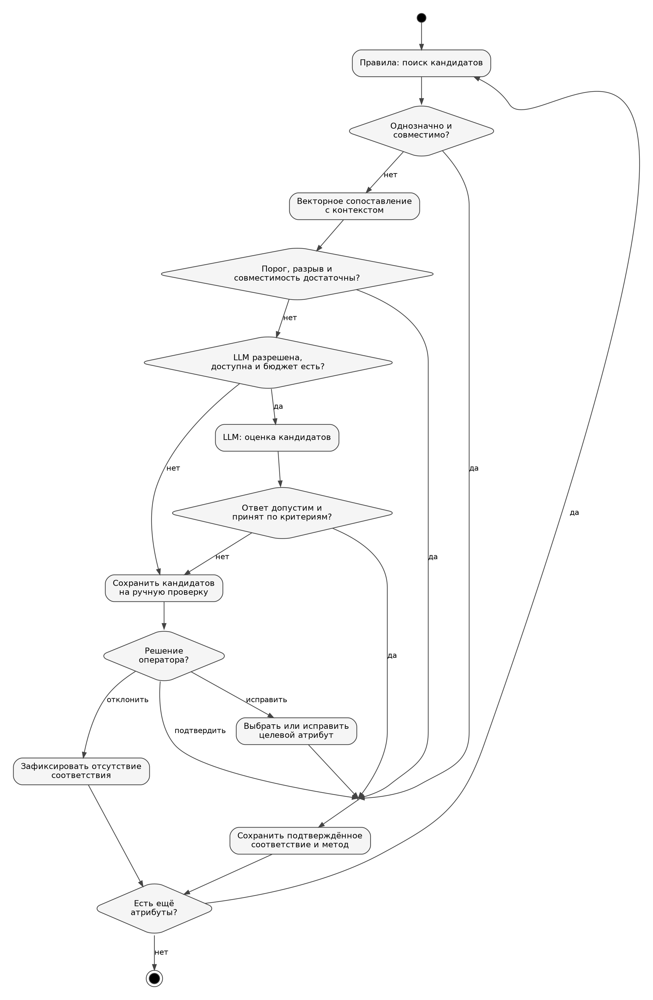
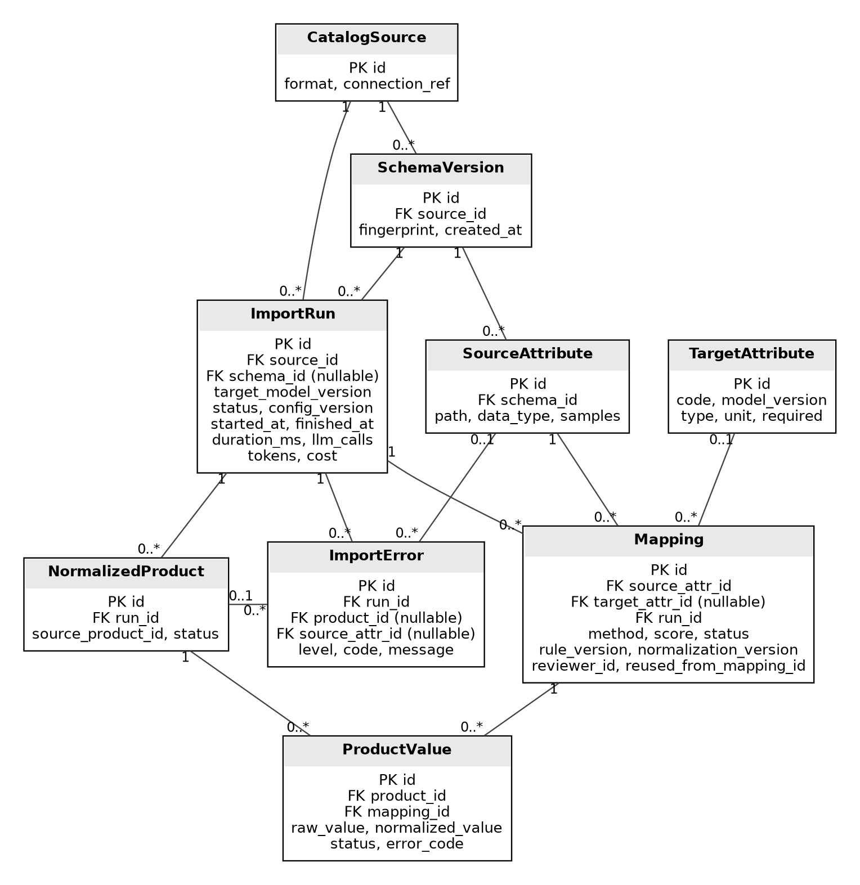
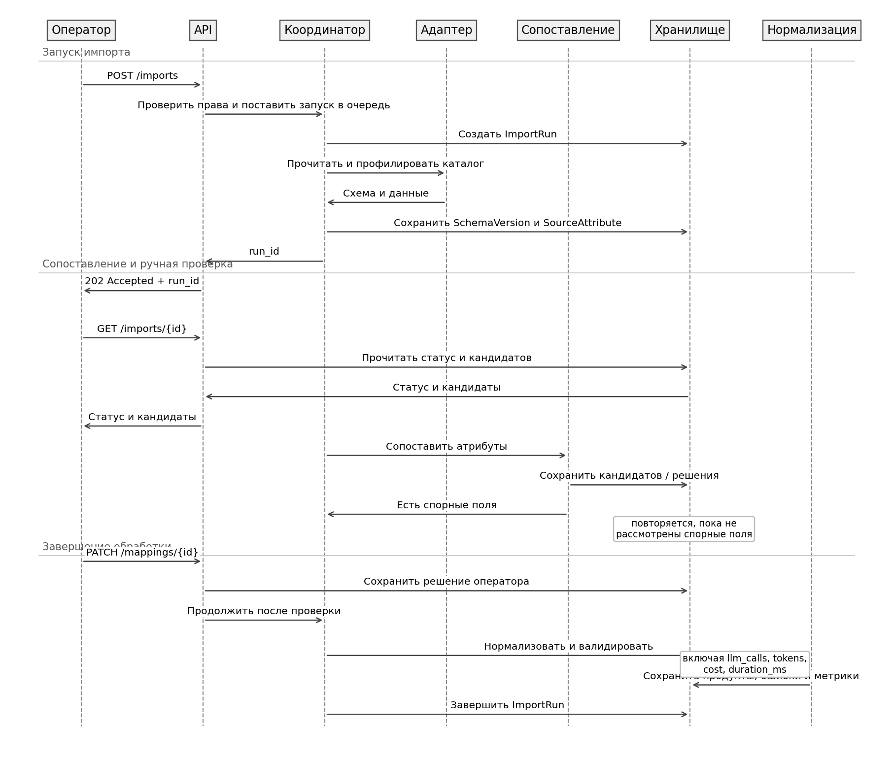
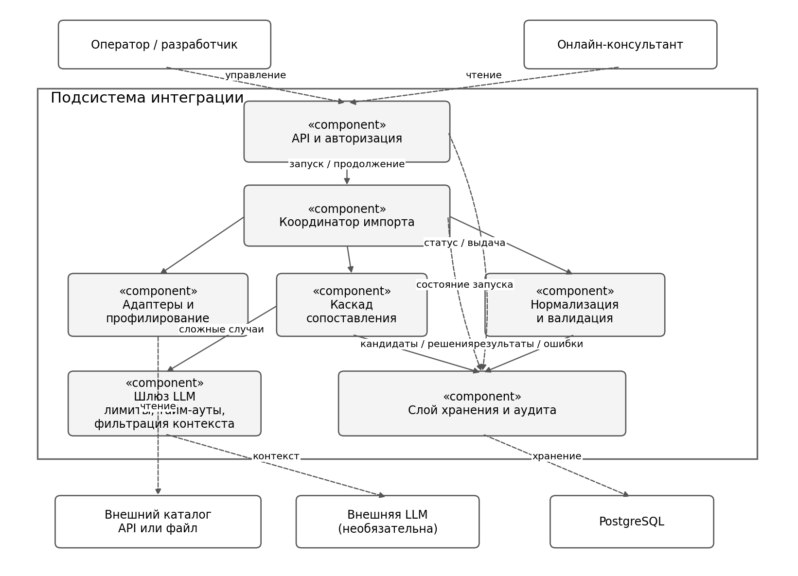
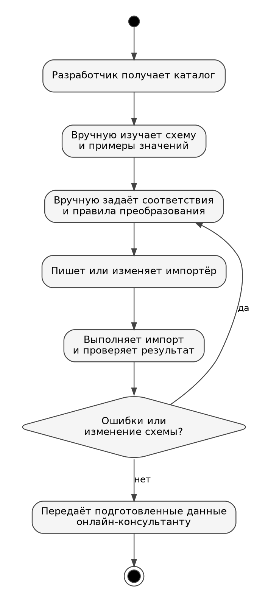
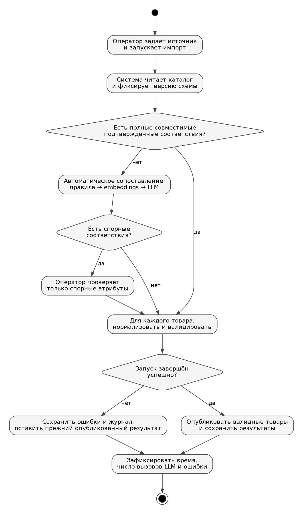

# ЛР 3 – проектирование

**Тема ВКР:** Разработка подсистемы интеграции и семантической нормализации разнородных товарных каталогов для интеллектуального онлайн-консультанта.

**Автор:** Машковцева Марина, группа K3440. Работа индивидуальная.

## 1. Предметная область и требования

### Описание предметной области

Интеллектуальному онлайн-консультанту необходимы согласованные сведения о товарах для поиска и подбора предложений. Интернет-магазины предоставляют каталоги через API и файлы JSON, XML, YML, CSV. Даже внутри одной товарной категории различаются названия и вложенность атрибутов, типы данных, единицы измерения и справочные значения. Например, поля `diagonal` со значением `27 in` и `screen_size` со значением `68.58 cm` могут описывать одну характеристику. Сначала требуется установить соответствие полей, затем выполнить преобразование значений.

Подсистема предназначена для разработчика или оператора интеграции, который подключает источники и проверяет спорные соответствия. Другой компонент системы, онлайн-консультант, получает готовые товарные данные через API. Покупатель непосредственно с подсистемой не взаимодействует. Реализация диалогового интерфейса, поискового движка и дедупликация товаров между магазинами не входят в границы ВКР.

В качестве исходного подхода рассматривается ручная настройка преобразований при подключении каждого источника. В проектируемом решении соответствия предлагаются последовательно: сначала на основе правил, затем с помощью векторных представлений, при необходимости с помощью большой языковой модели (LLM). Сомнительные результаты передаются оператору. Подтверждённые соответствия сохраняются для повторного использования в пределах совместимой версии схемы и целевой модели. Преимущество каскада по качеству и затратам является гипотезой, а не результатом уже проведённых измерений.

### Функциональные требования

| ID | Требование | Как проверить выполнение |
|---|---|---|
| FR-01 | Подключать каталог из файла CSV, JSON, XML/YML либо через HTTP API; фиксировать параметры источника без сохранения секретов в открытом виде. | Загрузить тестовый каталог каждого формата и получить идентификатор запуска; повреждённый файл должен приводить к диагностируемой ошибке. |
| FR-02 | Выделять атрибуты исходной схемы, их пути, типы и примеры значений; регистрировать версию схемы. | Загрузить плоский и вложенный каталоги; сравнить выделенные поля с эталоном; при изменении структуры проверить создание новой версии. |
| FR-03 | Формировать кандидатов на соответствие атрибутам единой товарной модели, применяя правила, векторное сопоставление и LLM по заданным условиям перехода. | На размеченном наборе полей проверить результаты каждого этапа, сохранённый метод и переход к следующему этапу при недостаточной уверенности. |
| FR-04 | Предоставлять оператору список спорных соответствий с кандидатами; принимать подтверждение, исправление или отклонение. | Создать неоднозначный атрибут, проверить появление задания на проверку, изменить предложенное соответствие и убедиться, что дальнейшая обработка использует решение оператора. |
| FR-05 | Нормализовать подтверждённые характеристики: типы, единицы измерения, форматы и предусмотренные моделью справочные значения. | Проверить, что `27 in` и `68.58 cm` дают одинаковую диагональ в принятой единице, а неизвестная единица вызывает ошибку преобразования. |
| FR-06 | Валидировать результат по ограничениям целевой модели; фиксировать отсутствующие или ошибочные значения без их выдумывания. | Передать запись без обязательного поля и запись с неверным типом; проверить диагностику и отсутствие таких товаров в выдаче валидных записей. |
| FR-07 | Сохранять версии схем, кандидатов, подтверждённые соответствия, результаты импорта и исходные идентификаторы товаров; повторно использовать совместимые подтверждённые соответствия. | Повторить загрузку неизменённой схемы и проверить использование сохранённых связей; изменить версию схемы или целевой модели и проверить повторную оценку соответствий. |
| FR-08 | Предоставлять через API статус импорта, результаты проверки и нормализованные валидные товары. | Запросить статус по идентификатору запуска, список спорных полей и выдачу товаров; убедиться, что данные соответствуют целевой модели. |
| FR-09 | Регистрировать результаты обработки: длительность, число обращений к LLM, расход токенов и ошибки; при наличии тарифа рассчитывать стоимость. | Выполнить тестовые запуски с LLM и без неё, сверить сохранённые показатели с журналом вызовов. |

### Нефункциональные требования

Пороговые значения ниже являются проектными условиями для прототипа, а не уже измеренными характеристиками системы. Их можно уточнить после выбора экспериментальных каталогов и моделей.

| ID | Требование | Как проверить выполнение |
|---|---|---|
| NFR-01 | Длительные импорты выполняются асинхронно; API возвращает идентификатор принятого запуска без ожидания обработки всего каталога. | На стенде с искусственной задержкой обработки 10 с проверить, что ответ на запуск возвращается раньше завершения импорта и статус доступен отдельно. |
| NFR-02 | Для каждого запуска ограничивается число обращений к LLM и время ожидания ответа; недоступность модели не должна приводить к принятию непроверенного соответствия. | Установить бюджет 2 вызова и тайм-аут 5 с; имитировать превышение бюджета и недоступность модели, проверить перевод спорных полей на ручную проверку. |
| NFR-03 | Решения о сопоставлении прослеживаются до версии схемы, целевого атрибута, метода и конфигурации; ручные решения содержат идентификатор проверяющего. | По сохранённому значению восстановить исходный атрибут, запуск и метод преобразования; проверить наличие сведений о ручном исправлении. |
| NFR-04 | Доступ к запуску импорта и изменению соответствий предоставляется оператору; потребитель API получает только валидные товары. Передача контекста во внешнюю LLM разрешается настройкой и не включает секреты подключения. | Проверить отказ при попытке изменения с ролью потребителя; отключить внешнюю передачу и убедиться в отсутствии вызовов LLM; проверить состав запроса к модели. |
| NFR-05 | Адаптеры источников и методы сопоставления разделены программными интерфейсами; подключение нового адаптера не требует изменения алгоритмов нормализации. | Добавить тестовый адаптер и выполнить существующий набор тестов сопоставления и нормализации без изменения их реализации. |
| NFR-06 | Неудачный запуск не уничтожает ранее опубликованный результат; ошибки отдельных записей сохраняются отдельно. | Выполнить успешный импорт, затем имитировать сбой нового запуска; проверить доступность прежних данных и наличие диагностики. |

## 2. Обзор нотаций и видов диаграмм

| Нотация или вид диаграммы | Что описывает | Сильные стороны |
|---|---|---|
| BPMN | Бизнес-процессы, события, задачи и участники | Показывает распределение ответственности и развилки процесса. |
| IDEF0 | Функции системы, входы, выходы, управляющие воздействия и механизмы | Позволяет декомпозировать сложную функцию и определить её границы. |
| IDEF3 | Сценарии выполнения процессов и последовательности работ | Удобна для фиксации альтернативных сценариев предметной области. |
| ER-модель | Сущности, атрибуты, ключи, связи и их кратности | Помогает проектировать структуру БД и ограничения целостности. |
| DFD | Потоки данных между процессами, хранилищами и внешними сущностями | Показывает происхождение, преобразование и назначение данных. |
| UML: диаграмма вариантов использования | Акторы и доступные им сценарии | Определяет границы системы и её функции с позиции пользователей. |
| UML: диаграмма активности | Порядок действий, условия, циклы | Подходит для алгоритмов с ветвлениями и сравнения процессов AS-IS и TO-BE. |
| UML: диаграмма последовательности | Сообщения между участниками во времени | Позволяет проверить порядок вызовов, асинхронное взаимодействие и обработку решений. |
| UML: диаграмма компонентов | Программные компоненты и зависимости | Показывает разделение ответственности и заменяемость частей системы. |
| C4 | Контекст, контейнеры, компоненты и код | Позволяет описывать архитектуру на нескольких уровнях детализации. |
| DMN | Правила и зависимости принятия решений | Удобна для формализации порогов и условий выбора метода. |

Справочные материалы: [спецификация UML 2.5.1](https://www.omg.org/spec/UML/2.5.1/), [BPMN 2.0.2](https://www.omg.org/spec/BPMN/2.0.2/), [DMN](https://www.omg.org/dmn/), [C4 model](https://c4model.com/).

## 3. Выбор нотаций для проекта

| Нотация или вид диаграммы | Что моделируем | Связанные требования | Почему подходит |
|---|---|---|---|
| UML: диаграмма активности | Каскад сопоставления, ручная проверка, процесс подключения каталога | FR-01–FR-07, FR-09; NFR-02, NFR-06 | Позволяет явно показать условия перехода между алгоритмами и альтернативные пути при ошибках. |
| ER-модель | Версии схем, атрибуты, кандидаты, запуски, товары и значения | FR-02–FR-07, FR-09; NFR-03, NFR-06 | Отражает связи между исходными данными, решениями и результатом преобразования. |
| UML: диаграмма последовательности | Запуск импорта, получение статуса, проверка соответствий и продолжение обработки | FR-01–FR-09; NFR-01, NFR-03, NFR-04 | Уточняет последовательность взаимодействия оператора, API и внутренних компонентов. |
| UML: диаграмма компонентов | Адаптеры, координатор, сопоставление, нормализация, API, хранение и шлюз LLM | FR-01–FR-09; NFR-01–NFR-06 | Определяет ответственность модулей, границы внешних вызовов и место реализации ограничений. |

DMN могла бы дополнительно описать условия выбора алгоритма, однако на текущем этапе эти условия удобно представить на диаграмме активности. Отдельная DFD также не обязательна: основные потоки и взаимодействия уже раскрыты в моделях компонентов и последовательности.

## 4. Модели системы

### 4.1 Каскад сопоставления атрибутов (UML, диаграмма активности)

Сопоставление выполняется для каждого атрибута после получения схемы. На первом этапе применяются правила для заранее известных обозначений и базовая проверка совместимости типов и ограничений. Если однозначное допустимое соответствие не найдено, векторная модель отбирает кандидатов с учётом названия, категории и примеров значений. Для автоматического принятия проверяются порог сходства, разрыв между лучшими кандидатами и совместимость с ограничениями целевой модели. Пороги настраиваются на отдельной выборке, а не назначаются по результатам тестового набора.

При недостаточной уверенности система сначала проверяет, разрешено ли обращение к LLM, доступна ли модель и не исчерпан ли бюджет вызовов. Только после этого используется LLM. Ответ проверяется по допустимым идентификаторам и формату, а его принятие зависит от настроенных критериев; самооценка уверенности модели не является достаточным доказательством корректности. Если результат не принят, оператор подтверждает один из кандидатов, исправляет предложенное соответствие либо отклоняет его. До решения спорное поле не используется для нормализации. Для отклонённого поля фиксируется отсутствие соответствия.

**Связь с требованиями:** FR-03 отражён тремя этапами поиска, FR-04 – веткой ручной проверки, FR-07 – сохранением решений, NFR-02 – условным вызовом LLM и переходом на проверку при недоступности, NFR-03 – сохранением метода и результата. FR-05 и FR-06 выполняются после завершения этого подпроцесса (см. TO-BE).

### 4.2 Логическая модель данных (ER)

Модель рассчитана на PostgreSQL. `CatalogSource` описывает источник; `SchemaVersion` хранит отпечаток его структуры; `SourceAttribute` содержит путь атрибута, тип и ограниченную выборку значений. `TargetAttribute` задаёт код, тип, каноническую единицу и обязательность характеристики в определённой версии единой товарной модели. `ImportRun` связывает обработку с источником, версией схемы и конфигурацией алгоритмов. Ссылка на `schema_id` допускается пустой на момент создания запуска, так как сама версия схемы определяется после чтения каталога. В самом запуске также фиксируется версия целевой модели.

`Mapping` хранит отдельного кандидата или решение: метод, оценку, статус (`candidate`, `confirmed`, `rejected`, `unmapped`), версию правила, версию нормализации, идентификатор проверяющего и при необходимости ссылку на ранее подтверждённое соответствие, которое было повторно использовано. При отсутствии соответствия внешний ключ целевого атрибута может быть пустым. Для подтверждённых связей он обязателен. Для пары запуск–исходный атрибут допускается не более одного подтверждённого соответствия; несколько кандидатов разрешены. Для данной редакции прототипа сопоставление ограничено одним целевым атрибутом на исходное поле; сложные преобразования нескольких полей требуют отдельного исследования.

`NormalizedProduct` относится к конкретному запуску и хранит исходный идентификатор товара и статус валидации. `ProductValue` связывает результат с подтверждённым соответствием и сохраняет исходное и преобразованное значение либо код ошибки. Отдельная сущность `ImportError` нужна для ошибок уровня запуска, конкретной товарной записи или исходного атрибута. Если обязательного исходного поля нет, значение не создаётся искусственно: ошибка фиксируется отдельно. При сохранении нового запуска предыдущий успешный результат остаётся доступным. Выдача выбирает валидные записи последнего успешно завершённого запуска; запуск со сбоем не заменяет опубликованные данные.

**Связь с требованиями:** FR-02 – версии схем и атрибуты; FR-03, FR-04, FR-07 – записи `Mapping`; FR-05, FR-06 – `ProductValue`, `NormalizedProduct` и `ImportError`; FR-09 – показатели `ImportRun`. NFR-03 обеспечивается внешними ключами, версиями и хранением происхождения решения, NFR-06 – раздельным хранением запусков и ошибок. Для повторного использования проверяется совместимость версии схемы, целевой модели и конфигурации. На физическом уровне необходимы ограничения уникальности, внешние ключи и транзакции; их выполнение будет проверено после реализации.

### 4.3 Взаимодействие при импорте (UML, диаграмма последовательности)

Показан сценарий подключения каталога, в котором есть спорные соответствия. Оператор передаёт параметры источника в API. После проверки прав координатор регистрирует запуск и API возвращает `202 Accepted` с идентификатором. Дальнейшая обработка выполняется отдельно от HTTP-запроса. Координатор читает и профилирует каталог через адаптер, сохраняет версию схемы и запускает сопоставление. Кандидаты доступны через запрос статуса. Если спорных полей несколько, цикл ручной проверки повторяется до тех пор, пока обязательные решения не будут приняты. После этого координатор запускает нормализацию и валидацию, затем сохраняет продукты, ошибки и итоговые метрики, после чего завершает `ImportRun`. Потребитель впоследствии получает валидные товары через API (см. модель компонентов и TO-BE).

**Связь с требованиями:** FR-01, FR-02 – создание запуска и сохранение схемы; FR-03, FR-04, FR-07 – кандидаты, подтверждения и цикл ручной проверки; FR-05, FR-06 – преобразование и проверка; FR-08 – статус; FR-09 – запись метрик и завершение запуска. NFR-01 отражён ответом `202 Accepted` и последующей асинхронной обработкой, NFR-03 – сохранением решений и параметров запуска, NFR-04 – проверкой прав на стороне API. При ошибке или отсутствии разрешения API возвращает соответствующий статус, а запуск не переводится в успешное состояние.

### 4.4 Архитектура подсистемы (UML, диаграмма компонентов)

Предлагается модульная архитектура на Python с API (например, FastAPI) и PostgreSQL. На диаграмме показаны логические компоненты и их зависимости; отдельное развёртывание каждого модуля на данном этапе не требуется. Пунктирными связями обозначены взаимодействия с внешними участниками и внешними системами.

| Компонент | Ответственность |
|---|---|
| API и авторизация | Приём команд оператора, выдача статуса и валидных товаров, разграничение доступа. |
| Координатор импорта | Асинхронное выполнение, управление состоянием запуска, ожидание ручной проверки и повторное использование соответствий. |
| Адаптеры и профилирование | Получение данных, разбор форматов и построение описания схемы. |
| Каскад сопоставления | Правила, векторный поиск, выбор дальнейшего метода и формирование кандидатов. |
| Шлюз LLM | Проверка разрешения, минимизация передаваемого контекста, тайм-ауты, бюджет и учёт вызовов. |
| Нормализация и валидация | Преобразование подтверждённых значений и контроль ограничений модели. |
| Слой хранения и аудита | Сохранение схем, соответствий, результатов и статистики, защита прежних результатов при сбое. |

**Связь с требованиями:** каждый компонент реализует соответствующую группу FR-01–FR-09. NFR-01 обеспечивается разделением API и координатора, NFR-02 – шлюзом LLM, NFR-03 – слоем хранения и аудита, NFR-04 – авторизацией и фильтрацией внешних запросов, NFR-05 – границами модулей и интерфейсами адаптеров, NFR-06 – отдельным хранением запусков. Технический выбор очереди задач, конкретной векторной модели и поставщика LLM остаётся открытым до реализации и экспериментальной оценки.

## 5. AS-IS и TO-BE

**Выбранная нотация:** UML, диаграмма активности.

### AS-IS – текущее состояние

AS-IS представляет типовой сценарий подключения нового каталога без разрабатываемой подсистемы, а не результаты наблюдения за конкретным интернет-магазином. Разработчик изучает структуру источника, определяет соответствия, настраивает преобразования и проверяет импорт. При ошибках либо изменении схемы часть действий повторяется. Основное ограничение состоит в том, что анализ и настройка выполняются вручную для каждого нового источника.

### TO-BE – предлагаемое состояние

Оператор задаёт источник, после чего система выделяет схему и проверяет наличие полного набора совместимых подтверждённых соответствий для данной версии схемы и версии целевой модели. Для неизвестной схемы запускается каскад из подраздела 4.1. Ручная проверка требуется только для соответствий, которые не удалось надёжно определить автоматически. Далее для каждого товара выполняются нормализация и валидация. При успешном завершении запуска публикуются только валидные товары и сохраняются результаты. Если запуск завершается с ошибкой, система сохраняет журнал и диагностику, но оставляет предыдущий опубликованный результат доступным.

### Обоснование перехода

| Операция AS-IS | Изменение в TO-BE | Требования | Как оценить улучшение |
|---|---|---|---|
| Ручное изучение структуры | Автоматическое выделение атрибутов и версии схемы | FR-01, FR-02 | Время подготовки схемы, полнота выделения полей |
| Ручное задание всех соответствий | Каскад и проверка спорных полей | FR-03, FR-04, NFR-02 | Precision, Recall, F1; доля корректных автоматических соответствий; число исправлений |
| Настройка преобразований | Единый механизм нормализации и проверки | FR-05, FR-06 | Доля корректно преобразованных тестовых значений, число ошибок |
| Повторная настройка при загрузке | Повторное использование совместимых подтверждённых связей | FR-07, NFR-03 | Число повторных операций сопоставления |
| Ручная передача и проверка результата | API, статусы, журналирование | FR-08, FR-09, NFR-01, NFR-06 | Время импорта, доступность прежнего результата при сбое, полнота диагностики |

Переход не исключает участие оператора: оно сосредоточено на спорных полях. Для оценки гипотезы в ВКР планируется сравнить правила, векторный метод, LLM для всех полей и каскад на одинаковых каталогах с эталонной разметкой. Метрики вычисляются на отдельных тестовых данных; учитываются доля корректных автоматических соответствий, число ручных исправлений, время и стоимость. Сокращение затрат и сохранение качества предстоит подтвердить экспериментально.

## 6. Выводы

Диаграмма активности описывает принятие решений при сопоставлении атрибутов, ER-модель определяет структуру хранения данных, диаграмма последовательности уточняет порядок взаимодействия, а диаграмма компонентов показывает распределение ответственности. Модели согласованы через общие сущности запуска, версии схемы, кандидата, подтверждённого соответствия и нормализованной записи.

Проектирование позволило определить условия перехода между методами, способ сохранения неоднозначностей, границы внешней LLM и правила публикации результатов. В TO-BE ручное описание каждого поля заменяется автоматическим предложением соответствий с проверкой спорных случаев. Повторные загрузки совместимых схем используют уже подтверждённые связи, а происхождение решений и ошибки сохраняются отдельно. Нефункциональные требования отражены в асинхронной обработке, ограничении внешних вызовов, версионировании, авторизации и сохранении результатов отдельных запусков.
